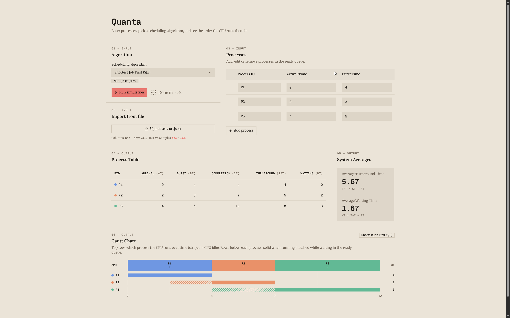

# Quanta — CPU Scheduling Simulator

An Operating Systems presentation project that simulates the **short-term CPU scheduler**:
how it selects processes from the ready queue and allocates the CPU to maximize utilization
and minimize waiting time.

Runs fully in the browser — React + TypeScript + Vite, no server.



## Algorithms

| Algorithm                               | Type           | Extra input  |
| --------------------------------------- | -------------- | ------------ |
| FCFS — First Come, First Served         | Non-preemptive | —            |
| SJF — Shortest Job First                | Non-preemptive | —            |
| SRTF — Shortest Remaining Time First    | Preemptive     | —            |
| RR — Round Robin                        | Preemptive     | Time Quantum |

## Features

- **Process input** — add, edit and remove processes (Process ID, Arrival Time, Burst Time) or upload a `.csv` / `.json` file.
- **Algorithm options** — choose an algorithm; set the Time Quantum for Round Robin.
- **Gantt chart** — execution timeline, including CPU idle time.
- **Process table** — Completion, Turnaround and Waiting Time for each process.
- **System averages** — average Turnaround Time and average Waiting Time.

## Metrics

```
Turnaround Time (TAT) = Completion Time - Arrival Time
Waiting Time   (WT)  = Turnaround Time - Burst Time
```

## Getting Started

Requires Node.js 20+.

```bash
npm install
npm run dev       # start dev server at http://localhost:5173
npm run build     # type-check and build for production
npm run preview   # preview the production build
npm run lint      # run oxlint
```

## Input File Format

**CSV** (header row required):

```csv
pid,arrival,burst
P1,0,5
P2,1,3
P3,2,8
```

**JSON**:

```json
[
  { "pid": "P1", "arrival": 0, "burst": 5 },
  { "pid": "P2", "arrival": 1, "burst": 3 },
  { "pid": "P3", "arrival": 2, "burst": 8 }
]
```

Rules: Process IDs must be unique, Arrival Time is an integer ≥ 0, Burst Time is an integer ≥ 1.
Sample files are in `public/samples/`.

## Project Structure

```
src/
├── types/          # Process, Schedule and result types
├── algorithms/     # fcfs, sjf, srtf, roundRobin — pure scheduling functions
├── lib/            # metrics, validation, CSV/JSON parsing
├── hooks/          # useSimulator — app state and simulation run
└── components/
    ├── input/      # process table, file upload, algorithm selector
    ├── output/     # Gantt chart, results table, averages
    └── layout/     # shared layout pieces
public/samples/     # sample input files
docs/               # presentation notes and worked examples
```

See [CLAUDE.md](CLAUDE.md) for the full system design, scope and tie-breaking rules.
